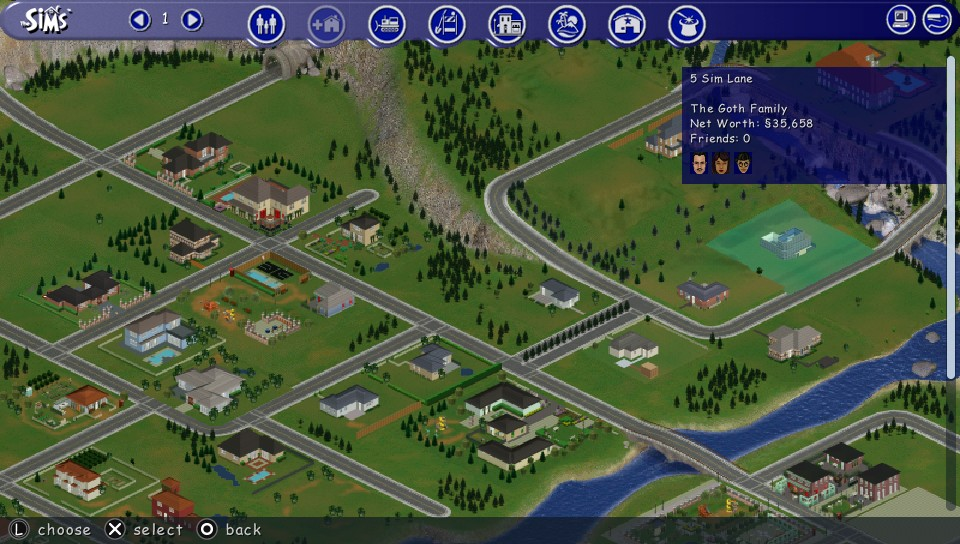
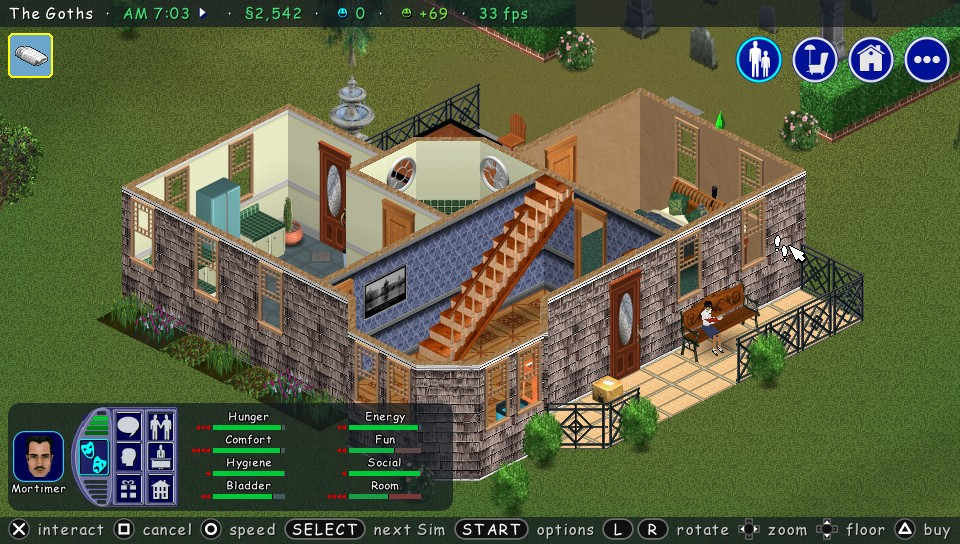
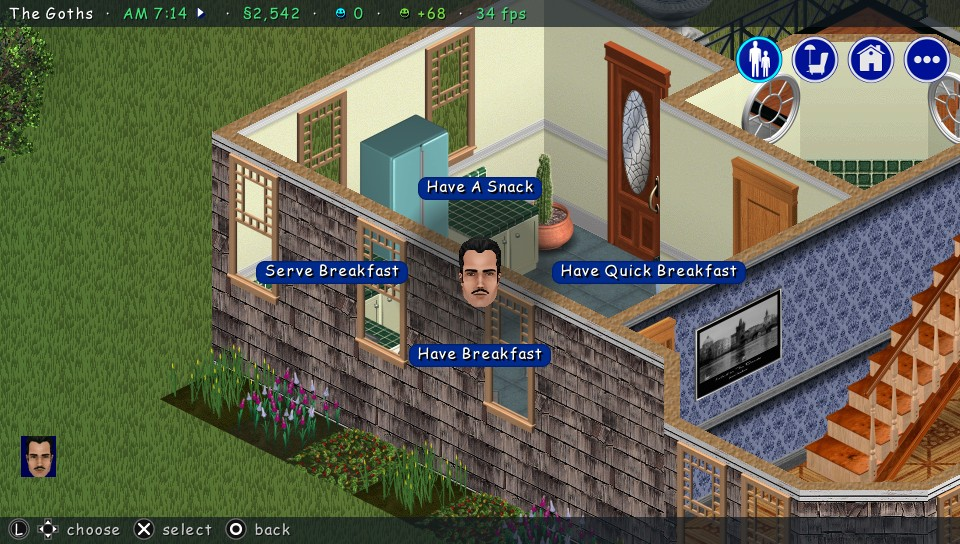
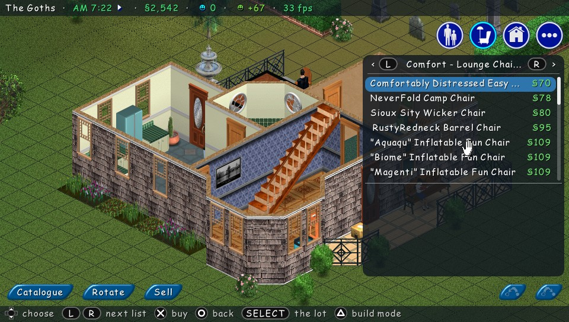
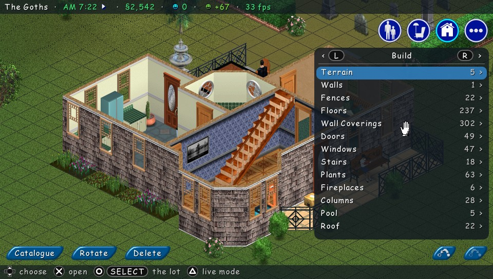
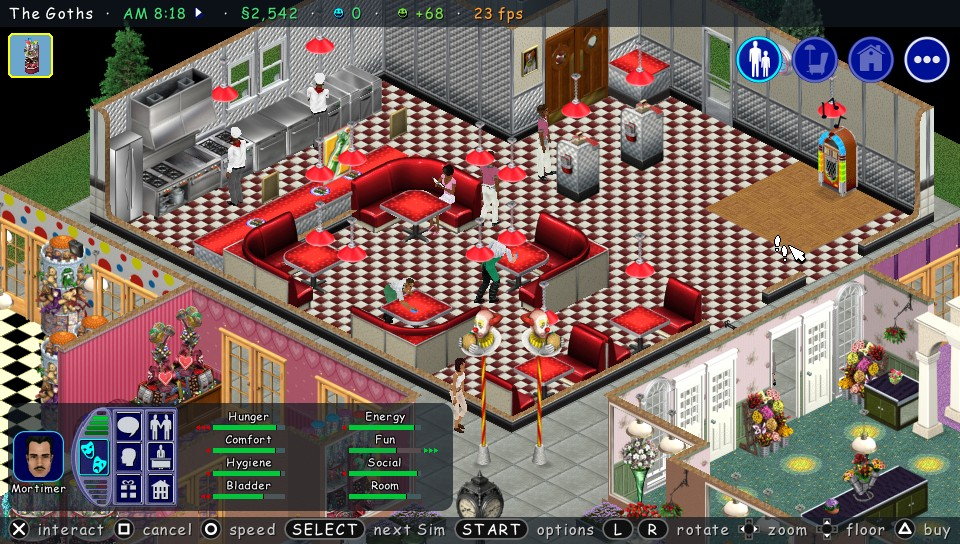
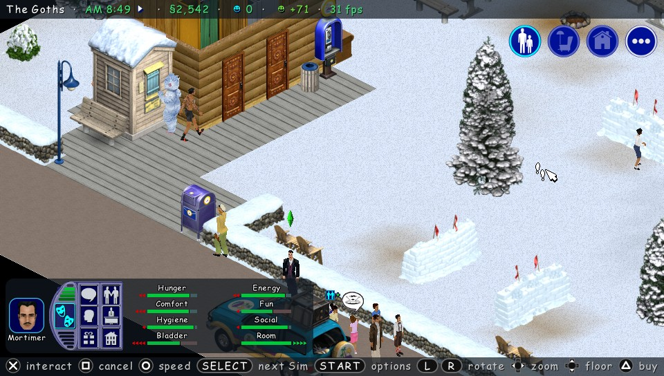
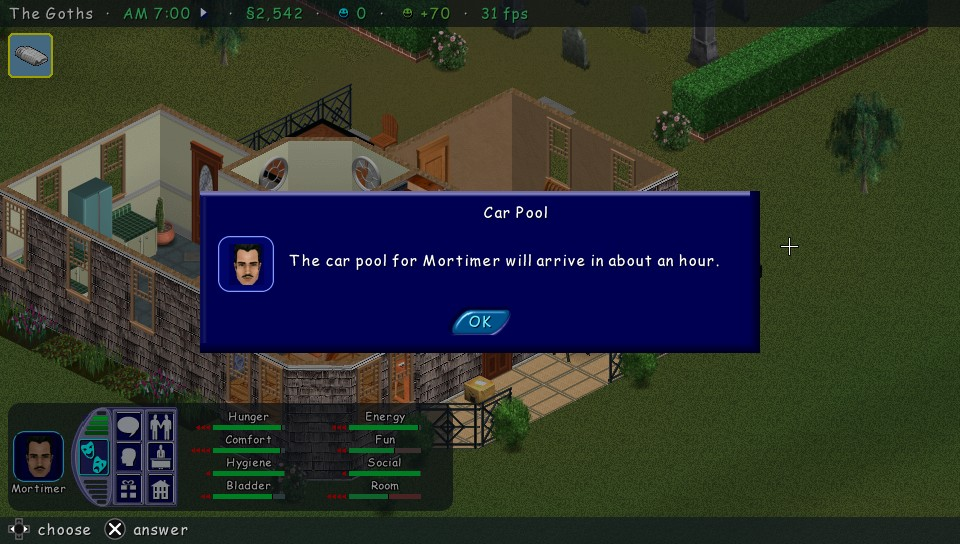
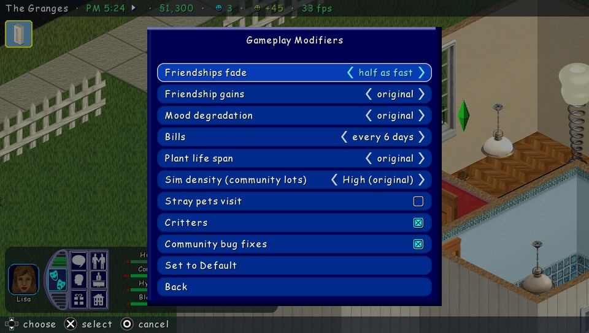

# The Sims for PS Vita (unofficial port)

A native PS Vita engine that plays **The Sims** (2000), with all seven expansion packs, from
**your own copy of the game's files**. It isn't an emulator and not a PC port: a new engine, written
for the Vita, that reads the original game's data and runs the game's own code for the Sims and their
objects.

The download contains no game data: you copy the folders from your own install of
**The Sims Legacy Collection** to the Vita's memory card.

> Work in progress. Expect bugs and missing pieces; please report what you find
> (see [Reporting a problem](#reporting-a-problem)).

## Screenshots

| | |
|---|---|
|  |  |
| The neighbourhood | Live mode |
|  |  |
| A pie menu | Buy mode |
|  |  |
| Build mode | Downtown (Hot Date) |
|  |  |
| Vacation Island | The game's messages |
|  | |
| Optional gameplay modifiers | |

All taken on a PS Vita, at its own 960 × 544.

## Features

- **The whole game:** the base game plus Livin' Large, House Party, Hot Date, Vacation, Unleashed,
  Superstar and Makin' Magic, with their objects, Sims, careers and events.
- **Live mode:** needs and moods, skills, jobs and the car pool, school, friendships and the social
  interactions, free will, visitors, the maid and the other service Sims, burglars, fires, the
  Grim Reaper, bills and the mail, pets, and the rest of what the game's own code does.
- **Buy mode and build mode:** the full catalogues with their pictures; walls, fences, floors, wall
  coverings, doors, windows, stairs, columns, pools, terrain and roofs.
- **Going out:** cabs, car and balloon trips to Downtown, Vacation Island, Old Town, Studio Town and
  Magic Town, and home again.
- **Neighbourhoods and families:** every neighbourhood of the install, families moving in and out,
  Create a Family.
- **Sound and music:** the game's own sound engine and its music.
- **Saves:** every lot saved on the memory card, with autosave.
- **Ad hoc Share:** send a lot, with its family, from one Vita to another nearby (no internet
  needed). Custom content used on the lot can go with it. From the internet button on a town's map.
- **To and from the PC game:** export a family from the Vita's neighbourhood map for the PC version
  (Legacy Collection) and import the PC game's family files (`.FAM`) on the Vita.
- **Custom content:** the install's own `Downloads` are read, and more can be added in
  `ux0:data/TheSimsVita/Downloads` (see [Files on the memory card](#files-on-the-memory-card)).
- **Made for the Vita:** pad and touch controls, ~30 fps on most lots, a cleaner interface with
  remastered mode buttons, a battery saver setting.
- **Optional gameplay modifiers** (all off unless you choose them; see
  [Gameplay modifiers](#gameplay-modifiers)).

## What you need

- A PS Vita or PS TV with **HENkaku / Ensō** (any firmware that runs homebrew) and **VitaShell**.
- **The shader compiler** `ur0:data/libshacccg.suprx`. If you've installed other vitaGL ports, you
  already have it. If not, install [ShaRKF00D](https://github.com/Rinnegatamante/ShaRKF00D/releases),
  run it and choose to extract the compiler.
- **The Sims Legacy Collection**, installed on a PC (Steam or the EA app).
- About **3 GB free** on the Vita's memory card (`ux0:`).

Other editions of The Sims (the original discs, the Complete Collection) have not been tested.

## Installing

1. **Download** `TheSimsVita-vX.Y.vpk` and `copy_to_vita.cmd` from the
   [latest release](../../releases/latest).
2. **Find your game's install folder** on the PC. In Steam: right-click The Sims Legacy Collection ›
   Manage › Browse local files. Usually
   `C:\Program Files (x86)\Steam\steamapps\common\The Sims Legacy Collection`.
3. **Copy the game's files to the Vita**, to `ux0:data/TheSims/`:
   - **On Windows:** start VitaShell on the Vita and press **SELECT** (USB mode); the Vita's memory
     card shows up as a drive on the PC. Then run `copy_to_vita.cmd` with that drive's letter and your
     install folder, for example:
     ```
     copy_to_vita.cmd E "C:\Program Files (x86)\Steam\steamapps\common\The Sims Legacy Collection"
     ```
   - **By hand (any computer, USB or FTP):** copy these folders from the install folder into
     `ux0:data/TheSims/`, keeping their names. Copy whichever exist:
     `GameData`, `SoundData`, `Music`, `UIGraphics`, `ExpansionShared`, `ExpansionPack`,
     `ExpansionPack2` … `ExpansionPack7`, `Deluxe`, `Downloads`, `UserData`, `UserData2` … `UserData8`.

   Check: the file `ux0:data/TheSims/GameData/UIText.iff` must exist.
4. **Install the VPK:** copy it to the Vita (e.g. to `ux0:`), open it in VitaShell and press **✕**.
5. **Start it** from its bubble. The **first start indexes the game's files and takes a few
   minutes**; later starts are quick.

## Updating

Install the new VPK over the old one. Your saves and options are kept: they live in
`ux0:data/TheSimsVita/`, not in the app.

## Controls

| | Pad | Touch |
|---|---|---|
| Move the pointer | Left stick | — |
| Interact / choose | ✕ | Tap |
| Cancel the Sim's action / back | □ / ○ in menus | Tap the action's icon |
| Game speed, pause | ○ | Tap the clock |
| Next Sim | SELECT | Tap a face |
| Options | START | The ⋯ button |
| Move the view | Right stick (or the pointer at the screen's edge) | Drag |
| Rotate | L / R | Two-finger twist |
| Zoom | D-pad ← / → | Pinch |
| Floor up / down | D-pad ↑ / ↓ | — |
| Live, buy and build mode | △ (in turn) | The mode buttons |

The bar along the bottom always shows what the buttons do at that moment.

## Options

START opens the options: the view (walls up, cut away, down, roofs), music and sound volumes, pointer
and camera speed, free will, hints and more, saving, and going back to the neighbourhood.

### Gameplay modifiers

Options › Game › Gameplay modifiers. Ways to play that differ from the original game, each at its
original setting unless you change it; **Set to Default** puts them all back.

| Modifier | Settings |
|---|---|
| Friendships fade | original, half as fast, never |
| Friendship gains | original, double, triple |
| Mood degradation | original, slow, slower |
| Bills | every 3 days (original), every 4, 5, 6 or 7 days, off |
| Plant life span | original, x2, x5, immortal |
| Sim density (community lots) | high (original), medium, low |
| Stray pets visit | on, off |
| Critters (El Bandito the raccoon, the skunk) | on, off |
| Community bug fixes | on, off: fixes for bugs in the original game that the community made as patch files, done in the engine |

## Files on the memory card

| Where | What |
|---|---|
| `ux0:data/TheSims/` | Your copy of the game's folders (only read) |
| `ux0:data/TheSimsVita/saves/` | Your saved lots and neighbourhoods. **Back this folder up**; delete a lot's `.sav` to start it afresh |
| `ux0:data/TheSimsVita/options.txt` | Your options |
| `ux0:data/TheSimsVita/Downloads/` | Optional: more custom content (`.iff` / `.far` objects, skins, walls, floors), read at every start |
| `ux0:data/TheSimsVita/Export/` | Families exported for the PC game (copy them to the PC game's `UserData/Import`) |
| `ux0:data/TheSimsVita/Import/` | Families from the PC game (its `UserData/Export/*.FAM`): the Import button on the neighbourhood's bar brings them in |
| `ux0:data/TheSimsVita/index.cache` | The index of the game's files (made again if deleted) |
| `ux0:data/TheSimsVita/log.txt` | The last session's log; earlier ones are in `logs/` |
| `ux0:data/TheSimsVita/ui/` | Optional: your own interface pictures, used instead of the built-in ones |

## Troubleshooting

- **The app closes straight away or shows a black screen:** the shader compiler is missing. Check
  that `ur0:data/libshacccg.suprx` exists (see [What you need](#what-you-need)).
- **"The Sims' files weren't found in ux0:data/TheSims":** the game's folders aren't where the
  app looks. `ux0:data/TheSims/GameData/UIText.iff` must exist (not
  `ux0:data/TheSims/The Sims Legacy Collection/GameData/...`).
- **The first start seems stuck:** indexing takes a few minutes from a memory card. Leave it.
- **Added custom content doesn't show up:** restart the app; added content is read at start.

## Reporting a problem

Please [open an issue](../../issues/new/choose) and pick **Bug report**. The form asks for what you
did, what happened and what you expected, and the log:
`ux0:data/TheSimsVita/log.txt` (or the latest file in `ux0:data/TheSimsVita/logs/` if the app has
been started again since). A screenshot (PS + START on the Vita) and the lot's save
(`ux0:data/TheSimsVita/saves/`) help a lot.

## Licences and source code

The app is closed source, with these exceptions:

- Parts of the engine are ported from [FreeSims](https://github.com/francot514/FreeSims) and
  [FreeSO](https://github.com/riperiperi/FreeSO), under the Mozilla Public License 2.0. Those files'
  source, as in each release, is in [`source/`](source/).
- The app uses [vitaGL](https://github.com/Rinnegatamante/vitaGL),
  [vitaShaRK](https://github.com/Rinnegatamante/vitaShaRK) and pthread-embedded, under the GNU LGPL.
  Each release has their source (`-lgpl-sources.zip`) and the app's object files for relinking it
  with modified versions of them (`-relink-kit.zip`).

Every third-party component and its licence: [NOTICES.md](NOTICES.md).

## Disclaimer

This is an unofficial fan project, not affiliated with, endorsed or sponsored by Electronic Arts or
Maxis. The Sims is a trademark of Electronic Arts Inc. No game files are included or distributed:
you need your own legal copy of the game.
